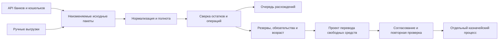

# 100 касс: ежедневная сверка и управление остатками

**Автор кейса: Ксения Божко · финансовый контролёр / финансовый аналитик**

Проект системы, которая ежедневно отвечает на четыре вопроса: **где деньги, сходится ли учёт, сколько действительно доступно и куда направить свободный остаток**.

[Открыть демо-панель](https://kks374038-commits.github.io/finance-portfolio/cases/reconciliation-100/) · [Техническое задание](docs/TECHNICAL_SPEC.md) · [Контракты данных](docs/DATA_CONTRACTS.md) · [Критерии приёмки](docs/ACCEPTANCE.md)


> Это проектный портфолио-кейс и работающий офлайн-прототип расчётного ядра. Реальные банковские API не подключены, платежи не выполняются. Все примеры счетов, операций, комиссий и сумм синтетические. Запись интервью, полная расшифровка, сведения об участниках и реквизиты в репозиторий не включены.

## Бизнес-задача

Вместо единой кассы — около 100 банковских счетов и кошельков. Одни данные доступны через API, другие поступают из ручных выгрузок. Несколько банков и валют могут скрываться под общим названием, а запись о переводе в учётной системе не всегда означает, что деньги действительно дошли.

При росте объёма возникает несколько связанных проблем:

- остатки сверяются с задержкой; пропуски операций, возвраты и комиссии обнаруживаются поздно;
- учётное зачисление может появиться раньше фактического получения;
- нет единого представления о незавершённых переводах и будущих выплатах клиентам;
- деньги могут оставаться на невостребованном счёте, пока на другом не хватает ликвидности;
- сведения повторно вводятся в несколько таблиц и систему учёта.

**Моя задача в этом кейсе:** формализовать контроль, определить требования разработчику и показать проверяемый прототип на 100 логических кассах.

## Решение



### 01. Единый реестр

Стабильный ID для каждого сочетания счёта, юридического лица и актива; отдельные субсчета по валютам. Понятные названия, владельцы, источник, время среза и статус загрузки. Нет файла — отдельная проблема, а не нулевой остаток.

### 02. Три проверки вместо одной

1. **Движение:** начальный остаток + поступления − списания = конечный остаток учёта.
2. **Внешний источник:** конечный остаток учёта сверяется с банком или кошельком на одинаковый момент.
3. **Перевод:** фактическое списание и зачисление подтверждаются отдельно; возврат не считается успешным переводом.

### 03. Остаток превращается в решение

Доступный остаток очищается от внутренних резервов. Защищается собственный целевой остаток и операционный буфер донора. Система показывает давние свободные средства и дефициты, затем формирует проект перевода по разрешённому маршруту с учётом комиссии.

Для целевой системы ТЗ дополнительно предусматривает календарь клиентских выплат, возрастные корзины, курсы с источником и временем котировки, конвертации отдельными связанными проводками и пересчёт прошлых дат.

## Что работает в прототипе

| Возможность | Статус |
|---|---|
| Сверка 100 касс по нормализованному JSON | Реализовано |
| Decimal, раздельные валюты и USDT, проверка временного среза | Реализовано |
| Пропуски, несовпадения, ограничения и неполные движения | Реализовано |
| Контроль подтверждений внутренних переводов и возвратов | Реализовано |
| Ограничение предложений свободным остатком, комиссией, юрлицом и сетью | Реализовано |
| Демо-панель с поиском и фильтрами | Реализовано |
| Реальные API, импорт произвольных банковских XLSX/CSV, база и журнал согласований | Описано в ТЗ; не реализовано |
| Восстановление FIFO из первичных движений и прогноз потребности | Описано в ТЗ; не реализовано |
| Исполнение переводов | За пределами прототипа |

## Результат демонстрационного прогона

**100 касс → 61 без замечаний, 24 требуют внимания, 15 заблокированы для планирования.**

- 80 источников представлены API-фикстурами, 20 — примерами ручной загрузки. Это выбранный состав демонстрации, а не установленная пропорция реального бизнеса.
- Проверяются шесть сценариев внутренних переводов: подтверждённый, возврат с ошибочным учётным приходом, транзит, несовпадение сумм, подтверждённый возврат, неоднозначная связь.
- Сформированы **три черновика переводов** в RUB, USD и USDT. EUR-маршрут исключён из-за расхождения.
- Выполнены **20 автоматических тестов**. Это проверка прототипа, а не подтверждение промышленного внедрения.

Не заявляю фактическую экономию времени или возврат денежных средств: таких измерений в этом проекте ещё нет. KPI внедрения и способ измерения зафиксированы в ТЗ.

## Запуск без сторонних библиотек

Требуется Python 3.10+; расчётное ядро использует только стандартную библиотеку.

```bash
python scripts/build_demo.py
python -m unittest discover -s tests -v
python src/reconciliation.py --input examples/demo_input.json --output reports/demo_result.json
python -m http.server 8765
```

Открыть `http://localhost:8765`. Можно также открыть `index.html` из полного комплекта: данные подключаются локальным JS-файлом, загрузки финансовых файлов в сторонний сервис нет.

## Структура

```text
docs/                 ТЗ, контракты данных, приёмка и вопросы к заказчику
src/                  Расчётное ядро
scripts/              Воспроизводимый генератор демонстрации
tests/                Автоматические проверки
examples/             Только синтетические входные данные
reports/              Результат прогона и данные панели
index.html            Интерактивная демонстрация
```

### Принцип проектирования

**Нельзя перераспределять деньги, пока не подтверждены источник, доступность и обязательства.** Автоматизация помогает контролёру работать по исключениям, сохраняя ответственность и историю решений.
